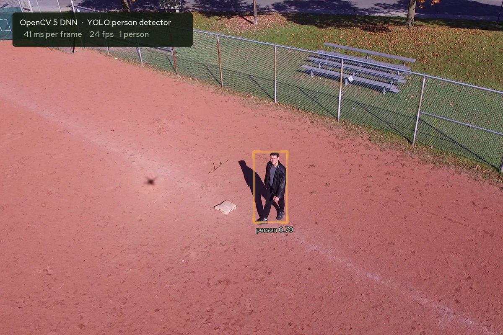
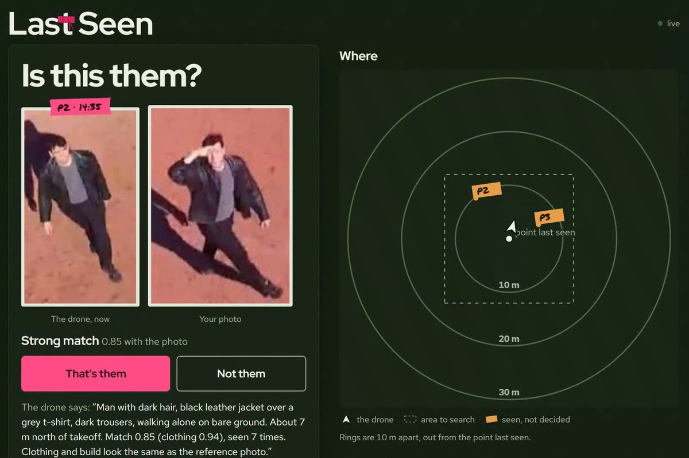
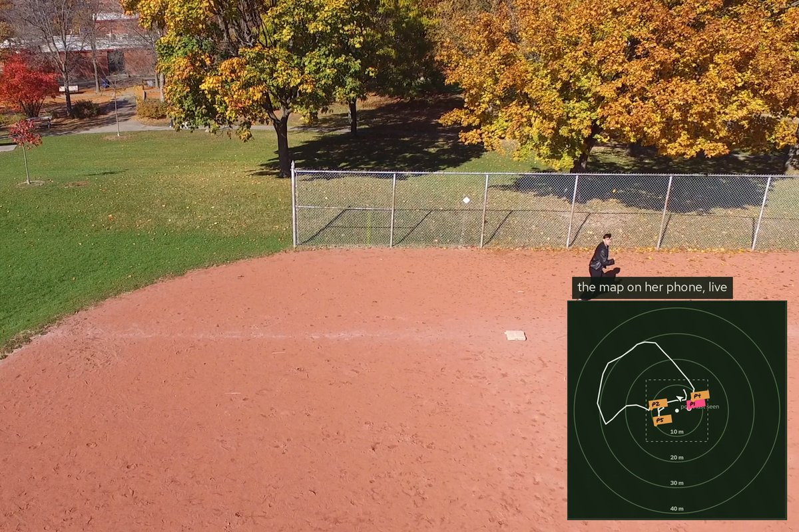
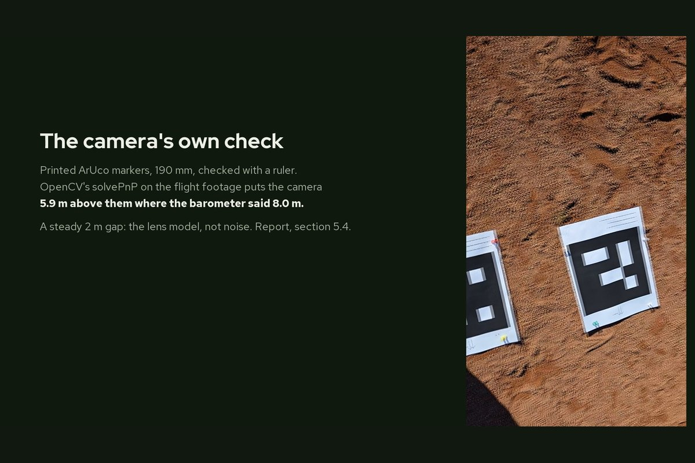
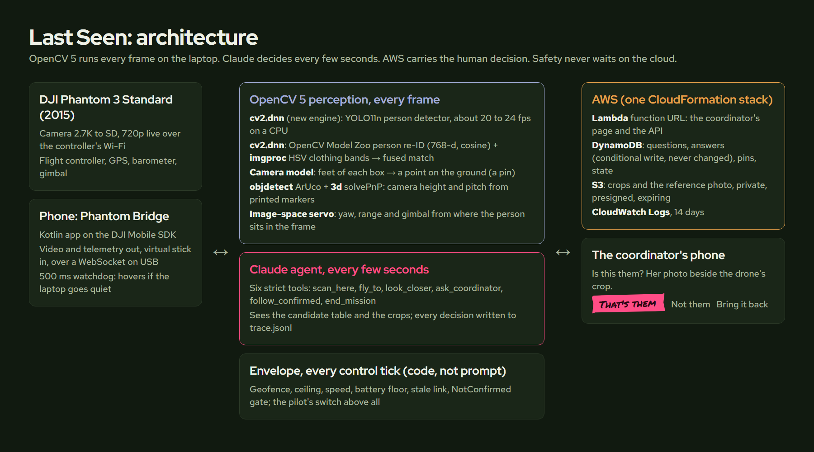
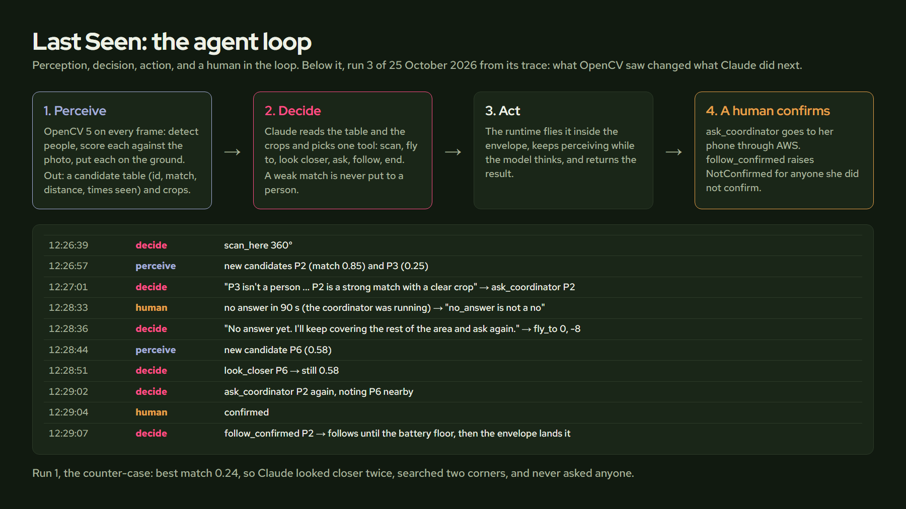

# Last Seen

A drone that searches a field for a person from one photo, asks a human before it
follows anyone, and keeps their position on the coordinator's map. Built on an
eleven-year-old DJI Phantom 3 Standard, OpenCV 5, Claude, and AWS, for the OpenCV AI
Competition 2026.

- **Demo video:** https://www.youtube.com/watch?v=b4s_inmWlk8
- **Write-up:** https://jonathanandrei.com/blog/last-seen-drone-finds-person-from-one-photo-opencv/
- **Report, with every number and where it came from:** [docs/REPORT.md](docs/REPORT.md)

| | |
|---|---|
|  |  |
| OpenCV 5's DNN engine runs YOLO on the drone's own video, 41 ms a frame on a laptop CPU. | Run 3 found me on its first scan at 0.85 and asked. Nothing follows until a human answers. |
|  |  |
| After "that's them", it follows and drops a pin every second. Run 2: 90 s, 49 pins. | solvePnP on the printed markers in the footage: camera 5.9 m up where the barometer said 8.0 m. |

## What happened on 25 October 2026

Three missions in a public park, the author playing the missing person. Everything
below is read from the run files in `brain/runs/last-seen/`.

| Run | Reference photo | What the agent did | Result |
|---|---|---|---|
| 1, 12:05 | taken from the ground, eye level | scanned, looked closer twice, searched two corners; best match 0.24 | never asked; recalled by the coordinator. The right behaviour for a weak match, and the hard case (a ground photo against an aerial view) stated as the main limit |
| 2, 12:11 | aerial crop | scan, look closer (0.76), asked, confirmed, followed 90 s | 49 pins; lock held 47% of frames, 7 identity drops, all reported by the agent in its own summary |
| 3, 12:26 | aerial crop | found on the first scan at 0.85, asked, confirmed, followed | battery reached its 18% floor after 64 s of following; the envelope aborted and the aircraft landed itself |

The printed ground markers were caught in the onboard video, so the camera check ran on
the footage afterwards: from a single 190 mm marker, `solvePnP` puts the camera
2.0 m lower than the barometer says, steadily, which points at the spec-sheet lens
model (report 5.4). Pin error against the subject's phone GPS was planned and not
measured; the report says why.

## How it works





```
 Phantom 3 Standard  --Wi-Fi-->  phone (Kotlin bridge, DJI MSDK)  --USB-->  laptop (Python)
   720p video, telemetry            video out, sticks in                 OpenCV 5 at frame rate
                                                                         Claude at decision rate
                                                                         envelope on every tick
 coordinator's phone  <--HTTPS-->  AWS: Lambda function URL + DynamoDB + S3  <--HTTPS-->  laptop
   Is this them?                     questions, answers, pins, crops
```

Three loops, kept apart on purpose:

- **OpenCV 5, every frame.** `cv2.dnn` (the new graph engine) runs YOLO11n for people,
  about 50 ms a frame on a laptop CPU. Each person is compared with the photo two
  ways: the OpenCV Model Zoo person re-identification network (`person_reid_youtu_2021nov`)
  and HSV clothing histograms by body band. A camera model turns the feet of each box
  into a point on the ground. An image-space servo (yaw from horizontal offset, range
  from box height, gimbal from vertical offset) flies the follow without needing
  calibration. ChArUco calibration (`calib`) and ArUco ground markers with `solvePnP`
  (`3d`) are implemented and tested in simulation for measuring the camera's real
  pitch; they were not flown.
- **Claude, every few seconds.** Six strict tools: `scan_here`, `fly_to`, `look_closer`,
  `ask_coordinator`, `follow_confirmed`, `end_mission`. The model sees the candidate
  table and the crops, and chooses. While it thinks, the runtime keeps the aircraft
  holding and perceiving. Every decision is in `trace.jsonl`.
- **A person, once.** `follow_confirmed` raises `NotConfirmed` for anyone the coordinator
  did not confirm; that is code, not a prompt, and it is tested. The coordinator can
  recall the aircraft from the page. The pilot's mode switch overrides everything.

The envelope (geofence, ceiling, speed, battery floor, stale-link abort) runs on every
control tick in `phantom_brain/pilot.py` and the agent cannot widen it.

## Mission control on AWS

`infra/lastseen.yaml` is one CloudFormation stack: a Lambda function behind a function
URL serving the page and the API, a DynamoDB table where a decision is a conditional
write (a second answer to the same question is refused with 409), a private S3 bucket
for crops with short-lived presigned links and expiry, and a 14-day log group.

```
python infra/deploy.py --profile lastseen      # creates or updates, prints the page URL
python infra/teardown.py --profile lastseen    # dry run: lists what it would delete
python infra/teardown.py --profile lastseen --yes
```

The same `App` serves the page locally (`python -m mission_control.server`) for a field
day without internet; what is tested is what is deployed.

## Layout

```
android/            Phantom Bridge: Kotlin app (DJI MSDK 4.18), video and sticks over a WebSocket
brain/phantom_brain/
  detect.py         CvDnnYoloDetector (OpenCV 5 DNN), letterbox, NMS
  reid.py           ReIdMatcher: model-zoo re-ID + clothing colour, fused score
  calib.py          ChArUco intrinsics, ArUco ground markers, solvePnP camera pose
  camera.py         pixel to ground
  visual_servo.py   ChaseController, TargetLock, gimbal step
  runtime.py        MissionRuntime: perceive, candidates, scan / fly_to / look_closer / follow
  tools/            the six tool definitions and the executor (structured errors)
  agent/            the Claude loop, the scripted stand-in, the coordinators
  pilot.py          FlightSession and the envelope
  sim/              simulator speaking the same protocol (real photos as sprites)
brain/mission_control/  the page, the App, the stores (memory, DynamoDB + S3), Lambda handler
brain/scripts/      last_seen.py (the mission), fieldup.py, calibrate_intrinsics.py, camera_truth.py, eval_reid.py
brain/runs/last-seen/   every mission: trace.jsonl, perception.jsonl, crops, pins
brain/tests/        159 tests, including the identity-gate regressions
infra/              CloudFormation, deploy, teardown
results/            reid_flight02.json and its contact sheet
flights/            per-flight logs, bugs, analysis scripts
docs/               REPORT.md, OPENCV26.md (the pre-build gate), DEMO_SCRIPT.md
check_claims.py     fails when a number in the docs no longer matches the data
```

## Setup

### Brain (Python 3.11+, tested on 3.14)

```
cd brain
python -m venv .venv
.venv\Scripts\activate
pip install -r requirements.lock.txt   # the exact pinned environment the flights ran in
pip install -e ".[dev]"
pytest -q                 # 159 tests, about five minutes, no hardware
```

Models (not in the repo):

```
powershell -c "Invoke-WebRequest https://huggingface.co/deepghs/yolos/resolve/main/yolo11n/model.onnx -OutFile models\yolo11n.onnx"
powershell -c "Invoke-WebRequest https://huggingface.co/opencv/person_reid_youtureid/resolve/main/person_reid_youtu_2021nov.onnx -OutFile models\person_reid_youtu_2021nov.onnx"
```

`ANTHROPIC_API_KEY` in the environment for the agent. `--agent scripted` runs the same
mission with a rule-based policy, labelled as such, for tests and for a field day
without a key.

### Bridge (Android)

1. Create a free app key at https://developer.dji.com (Mobile SDK, package
   `com.jonathanandrei.phantombridge`), copy `android\local.properties.example` to
   `android\local.properties` and paste it.
2. `cd android && gradlew :app:assembleDebug && adb install -r app\build\outputs\apk\debug\app-debug.apk`
3. First launch needs internet once for DJI registration.

## Run in the simulator

```
cd brain
python scripts\run_sim.py configs\sim_field.yaml --monitor          # terminal 1: the "phone"
python scripts\last_seen.py --reference data\reference.jpg --coordinator simulated   # terminal 2
```

The simulated coordinator is labelled as simulated in every log.

## Run with the real aircraft

Read `docs/PREFLIGHT.md`. Short version:

```
python scripts\fieldup.py                      # joins the RC Wi-Fi, installs, brings the link up, preflight, READY
python scripts\last_seen.py --reference <photo.jpg> --coordinator mission-control \
       --mission-control <Url from infra/outputs.json> --radius 12 --alt 8 --follow-s 60
```

Flip S1 to F and it takes off. Flip S1 back at any moment and the sticks are yours.

## Limits, stated plainly

- Identification is clothing and build, not a face. A photo in different clothes
  will not match. Two people dressed alike are both put to the coordinator.
- A photo taken at eye level scored the same person at 0.24 from the air; the system
  did the right thing (it did not ask) and the problem is not solved.
- One person was sometimes split into two tracks ("P1" and "P2" in run 2 were the
  same person). The agent reported the second track honestly; the fix is a better
  association rule, not a prompt.
- Autonomous takeoff failed on every attempt on 30 September and worked on 25 October;
  the takeoff retry in `pilot.py` exists because of that.
- No obstacle sensing: the aircraft is kept over open ground by the geofence and
  ceiling, not by seeing obstacles.

## Responsible use

Follows only a person a human confirmed, enforced in code. A weak match is never put
to a person. No face recognition. Crops live in a private bucket and expire. The
coordinator can recall the aircraft; the pilot's switch overrides all of it. The demo
subject is the author, with consent; the opening scenario is a composite and is
labelled as one.

## Legal (Canada)

The Phantom 3 Standard is 1,216 g: registered with Transport Canada, flown under a Basic
pilot certificate, in visual line of sight, away from bystanders and airports.

## Sources

- Phantom 3 Standard release: DJI press release, 5 August 2015, via
  [Newsshooter](https://www.newsshooter.com/2015/08/05/dji-launch-phantom-3-standard-a-799-drone-for-the-everyman/).
- Flight 01 bugs: `flights/2026-09-25-flight-01/BUGS.md`. Flight 02 takeoff failure:
  `flights/2026-09-30-flight-02/README.md`.
- Detector speed: measured live on the flight footage, drawn into the video.
- Re-identification on real aerial footage: `results/reid_flight02.json`.
- Runs 1 to 3: `brain/runs/last-seen/20261025-120518`, `-121053`, `-122602`.

## Where this came from

The repository began in September 2026 as a YouTube build rebuilding Andon Labs'
Drone-Bench tasks outdoors on this aircraft; the simulator, the bridge app, the
servo loop and the flight logs come from that work. It became Last Seen on 18 October
2026 (`docs/OPENCV26.md` is the brief).
